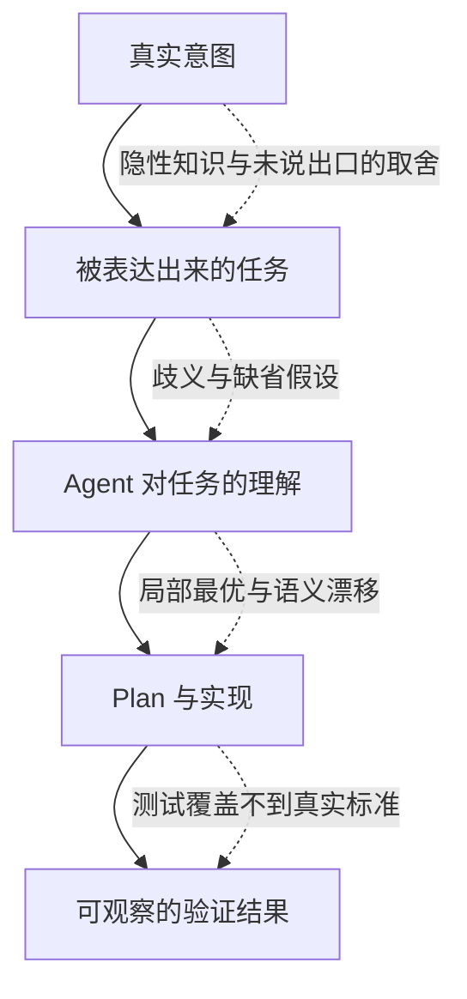
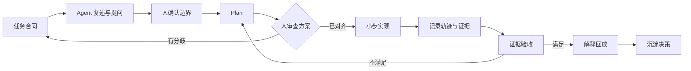

# Vibe Coding 时，如何缓解与 Agent 的认知偏差

> 先说结论：缓解认知偏差，关键不是让 Agent 更会猜，而是减少那些只能靠猜的部分。把目标、约束、成功标准和未知项外化成可检查的接口，让分歧在计划阶段暴露，而不是等系统已经跑偏之后再靠返工纠错。

Vibe coding 最危险的时刻，通常不是 Agent 写错了一行代码。更常见的是，人和 Agent 都觉得自己理解了任务，实际上却在讨论不同的事情：人说“做一个搜索”，想的是可审计、可降级的企业检索；Agent 听到“搜索”，先实现了关键词匹配。人说“先简化”，指的是减少依赖，Agent 却把核心能力也删了。两边都很努力，结果却从一开始就分叉。

这类问题可以统称为协作中的**认知偏差**。它不是指谁一定更聪明或更笨，而是双方掌握的信息、使用的概念、关注的目标和验证的标准不一致。Agent 执行得越快，这种不一致被放大的速度也越快。

## 一、偏差从哪里来

人与 Agent 并不是带着同一份工作记忆进入任务的。人脑子里有项目历史、组织约束、过去踩过的坑，以及对“差不多就行”和“绝不能妥协”的隐性区分；Agent 能依赖的主要是当前上下文里实际写出来的内容。

可以用下面四个层次理解这类偏差：



每经过一层，信息都可能被压缩。到了代码阶段，你看到的通常不是一个明确的错误，而是一套逻辑自洽、细节丰富、却建立在错误前提上的实现。它越完整，人越容易把“看起来合理”误认为“确实正确”。

因此，缓解偏差不能只靠一句“请仔细一点”。更有效的办法，是给每一层增加可观察的中间产物：

- 把真实意图变成任务合同；
- 把隐性上下文变成代码、文档、示例和约束；
- 把理解变成可审查的 Plan；
- 把“做完了”变成能被验证的证据。

## 二、最常见的六种偏差

| 偏差 | 典型表现 | 应该增加什么 |
| --- | --- | --- |
| 目标偏差 | Agent 优化了一个并不是你真正想要的结果 | 目标、非目标、完成定义 |
| 语义偏差 | 同一个词在人脑和上下文中含义不同 | 术语表、示例、反例 |
| 上下文偏差 | Agent 不知道组织习惯、历史决策或隐性约束 | 决策记录、约束清单、仓库地图 |
| 粒度偏差 | 双方对“先做最小版本”的尺度理解不同 | 范围边界、接口草图、验收样例 |
| 进展偏差 | 文件越来越多，人却越来越不理解系统 | 阶段性解释、人工走查、知识检查点 |
| 验证偏差 | 测试通过，但用户体验或业务目标仍然失败 | 分层验收、失败场景、真实样例 |

这六种偏差经常一起出现。比如“给后台加一个导出功能”这句话里，至少隐含了格式、数据范围、权限、性能、审计、失败重试和兼容性等假设。如果其中任何一项只存在于人的脑子里，Agent 就只能自行补全。

## 三、开始前：先对齐问题，再生成代码

### 1. 用一页“任务合同”固定共识

在让 Agent 动手前，我会先写一个足够短、但信息完整的任务合同。它不需要像正式 PRD 那么长，却必须能回答下面几个问题：

```text
目标：这次要改变什么，为什么现在要做？
完成定义：用什么可观察的结果判断完成？
非目标：这次明确不做什么？
约束：必须遵守哪些兼容性、性能、安全或架构边界？
参照：有哪些相似实现、反例或业务样例？
未知项：哪些问题尚未决定，遇到时应该停下来问谁？
```

其中最有用的往往不是“目标”，而是“非目标”和“未知项”。目标告诉 Agent 往哪里走，非目标告诉它不要顺手扩张，未知项则明确哪些地方不能靠猜测填满。

### 2. 让 Agent 复述，也让它提出反例

仅让 Agent 说一句“我理解了”，价值有限。更有用的检查是要求它同时给出：

1. 用自己的话重述目标；
2. 列出它正在采用的关键假设；
3. 给出一个可能被误实现的边界案例；
4. 指出任务合同里仍然含糊的地方。

如果 Agent 的复述和人的预期不一致，此时修正一句话的成本，远低于修改一套已经落地的实现。如果复述完全一致，也不要立刻跳过，因为双方可能只是共同使用了同一个模糊词。继续追问一个具体例子，往往才能看出语义是否真的对齐。

### 3. 用例子校准粒度

自然语言擅长表达方向，例子更擅长表达边界。与其说“处理各种异常”，不如提供三条具体输入：正常成功、可恢复失败、不可恢复失败，并分别写清期望行为。

可以用一个简单句式：

```text
给定……
当……发生时
那么系统应该……
并且不应该……
```

例子不需要覆盖全部实现，但要能压住最容易被不同理解方式分叉的地方。如果连例子都难以写出，通常说明问题本身还没有想清楚，不适合立刻交给 Agent 高速生成。

## 四、过程中：把“理解”做成中间产物

### 1. 先审 Plan，再审 Diff

Plan 的首要用途是让人和 Agent 确认是否在讨论同一件事，而不是证明 Agent 态度认真。一个可审查的 Plan 至少应该说明：

- 准备改哪些模块，为什么改这些模块；
- 哪些行为必须保持不变；
- 主要假设是什么；
- 预计如何验证；
- 哪些风险会导致方案回退。

当任务涉及跨模块改动时，我更倾向于先看一张数据流或调用关系图，再看文件清单。图能更快暴露“双方是否对系统结构有同一个心智模型”。如果图画不出来，通常也不适合直接进入大规模实现。

### 2. 在概念边界设置检查点

不要只按“写完了多少文件”设置检查点，而应该按概念边界设置：接口已经确定、数据权限已经明确、失败路径已经验证、核心流程已经跑通。

每个检查点都问三个问题：

- Agent 实际改动的范围，与 Plan 声称的范围是否一致？
- 当前实现依赖了哪些还没有被证明的假设？
- 如果现在停下，系统是否仍然可运行、可回滚、可解释？

这也是小步交付的价值。小步并不等于把任务切得很碎，而是让每一步都能被理解、被验证、被撤回。一次巨大的“全部完成了”，反而最容易掩盖偏差。

### 3. 让 Agent 扮演反方，而不是继续为自己辩护

当我对方案已经有倾向时，直接问“这样写对不对”，很容易得到强化既有判断的答案。更有效的做法是切换角色：

> 暂时不要修改代码。请假设这个方案会在生产环境失败，列出最可能的三种原因，并为每种原因设计一个能快速证伪的实验。

同样，也可以要求 Agent 从安全、可维护性、性能和数据一致性等不同视角审查同一个 Plan。多个视角的价值不在于投票，而在于把隐藏假设变成可讨论的问题。

### 4. 定期解释回放

每隔一个功能单元，让 Agent 用“如果向新同事介绍，这个模块为什么这样设计”的方式解释一次。人再复述一遍，指出自己仍然不理解的地方。

这一步不是形式主义。它能暴露三种常见风险：

- Agent 只是堆出了能运行的代码，无法解释关键取舍；
- 人已经失去对系统整体结构的把握；
- 文档、代码和双方口头理解已经出现分叉。

只有能被解释、被质疑、被修改的实现，才真正进入了人的认知范围。

## 五、结束时：用证据关闭偏差，而不是用感觉

### 1. 把验收标准逐条对应到证据

“测试通过”只是证据之一。一个功能可能测试全绿，却仍然不符合真实目标。结束时至少应核对下面几类证据：

| 验收问题 | 可观察证据 |
| --- | --- |
| 核心行为是否正确？ | 自动化测试、端到端流程、真实样例 |
| 边界行为是否符合预期？ | 失败场景、空数据、权限边界、并发场景 |
| 是否破坏既有能力？ | 回归结果、兼容性检查、灰度观察 |
| 是否引入了未声明的范围？ | Diff 审查、依赖变化、配置变化 |
| 是否可解释、可回滚？ | 设计说明、操作手册、回滚路径 |

验收时不要只问“做了什么”，还要问“哪里没有做”和“哪里可能会坏”。这两个问题更容易把 Agent 从完成态拉回到证据态。

### 2. 用真实样例挑战测试假设

测试本身也可能编码了错误理解。如果测试和实现出自同一个错误前提，它们会一起证明一个错误结论。因此，至少要加入一类不由实现反推出来的样本：用户真实输入、历史故障、业务规则文档，或者人工构造的反例。

这也是为什么“先写测试”并不能自动消除偏差。测试必须先对齐需求，才能真正成为协作契约；否则它只是把偏差固化得更早。

### 3. 把新的共识写回仓库

一次任务结束后，真正值得沉淀的不是聊天记录，而是那些以后仍然会影响判断的内容：

- 为什么选择这个方案，放弃了哪些替代方案；
- 哪些约束是硬边界，哪些只是当前阶段的取舍；
- 哪些词在项目中具有特定含义；
- 哪些失败场景已经被验证，哪些仍然是已知风险；
- 下一次修改时，哪些不变量不能被破坏。

可以用简短的 ADR、模块说明或仓库级协作规范保存这些信息。目的不是制造更多文档，而是减少下一个 Agent 和下一个协作者必须重新猜测的内容。

## 六、把观测对象从系统扩展到协作过程

到这里，这篇文章的方法还可以再往前走一步：认知偏差不仅是一个“怎么问”的问题，也是一个“什么状态被看见”的问题。如果目标、假设、判断依据和失败原因只存在于某一轮对话里，它们很快就会变成下一轮工作的猜测对象。

[《第十一讲. 让 agent 的运行过程可观测》](../external-sources/lecture-11-why-observability-belongs-inside-the-harness.md)把这种能力拆成两层：

| 观测层 | 主要回答的问题 | 在 vibe coding 中对应什么 |
| --- | --- | --- |
| 运行时可观测性 | 系统实际做了什么？ | 日志、追踪、进程事件、关键路径、错误上下文和健康检查 |
| 过程可观测性 | 为什么这个变更应该被接受？ | 任务合同、Plan、假设、评分标准、验收条件和人工决策 |

这两层必须同时存在。只看运行时，我们知道程序在哪一步失败，却可能不明白它为什么做了这个选择；只看过程文档，我们知道大家“打算怎么做”，却不知道实际执行是否忠于此前的共识。代码审查看的是“写了什么”，运行轨迹看的是“实际跑了什么”，两者缺一不可。

这个视角解释了为什么很多偏差会反复出现。Agent 说“可能和时序有关”，评估者说“感觉还不太对”，双方都进入了低信息状态：Agent 不知道下一步该验证什么，人也无法判断应该相信哪一部分。讲座对此有一个很直接的判断：没有可观测性时，评估容易变成主观判断，重试容易变成盲目摸索。

缓解方法不是要求 Agent 在每次失败后多写一段自我反思，而是把关键决策和证据变成 harness 自动采集、后续会话可以继续读取的轨迹。至少应记录：

- 这一轮依据的是哪一版任务合同；
- Agent 采用了哪些假设，哪些仍然未知；
- 修改了哪些关键路径，为什么选择这个方案；
- 每条验证结果对应哪项验收标准，失败上下文是什么；
- 人最终接受或拒绝了什么，理由是什么；
- 还有哪些已知风险和不变量需要在下一轮保留。

这里最重要的词是“结构化”，而不是“更多”。完整聊天记录并不等于可观测性，因为它保留了太多噪声，却没有明确哪些是决策、哪些是证据、哪些只是过程中的临时猜测。更好的任务是记录几个可查询的检查点：输入是什么、采用了什么判断、观察到了什么、下一步准备验证什么。

讲座还提醒，不能把信号采集完全交给 Agent 临时决定。Agent 往往不知道自己还需要记录什么，于是只留下它认为重要的信息，而这些信息可能恰好没有覆盖人的判断标准。在 harness 层面固定采集项，才能让不同会话、不同 Agent 和多轮修改留下可比较的轨迹。

可观测性还可以帮助人发现自己的偏见。每完成一个阶段，回看一次“Agent 的判断”和“人的判断”在哪里分叉：是目标理解错了、证据不足、评分标准模糊，还是人在看到实际结果后改变了偏好？重复出现的分叉不应该只被当成一次事故，而应该回写成更明确的合同条款、测试样例、评分维度或仓库规范。

最后要划清边界：可观测性让偏差更容易被发现，但它不会自动判断目标是否正确。日志可以证明系统做了什么，评分标准可以解释为什么接受当前结果，却不能替代人对“这个目标是否仍然值得做”的追问。观测是证据层，人的判断仍然是决定层。

## 七、一套可以马上使用的短流程

如果不想引入复杂流程，可以先从下面这套最小闭环开始：

1. **先写任务合同。** 用五分钟写清目标、非目标、完成定义、约束和未知项。
2. **让 Agent 反向复述。** 要求它列出假设、给出边界案例，并指出仍然不清楚的地方。
3. **先交付 Plan。** 只要涉及多个模块，就要求给出改动范围、关键不变量、验证方式和风险。
4. **给 harness 加观测点。** 固定记录任务合同版本、关键假设、验证结果、失败上下文和人工决定。
5. **按概念边界小步实现。** 每个检查点都能解释、验证和回滚。
6. **让 Agent 做一次反方审查。** 重点寻找会被当前测试遗漏的失败模式。
7. **逐条用证据验收。** 把完成定义对应到测试、真实样例、Diff 和回滚路径。
8. **把稳定共识写回仓库。** 记录决策、边界和仍然存在的未知项。



这套流程看起来比“一句话让 Agent 开干”慢，但它把返工从随机事件变成了可预期成本。真正被省下来的，通常不是几分钟写任务合同的时间，而是上线后排查、返工和重建理解的代价。

## 八、偏差不会归零，但可以被看见

没有任何提示词能让人和 Agent 永远保持同一理解。模型能力会继续变化，任务本身也会不断出现新的歧义。目标不是消灭所有偏差，而是让偏差尽早变得可见。

从这个角度看，vibe coding 的核心能力不只是“会提需求”，而是建立一套外部化、可观测的共识系统：用清晰的合同表达目标，用例子和仓库状态表达上下文，用 Plan 表达理解，用运行轨迹和过程工件解释实际发生了什么、为什么这个结果应该被接受。

Agent 可以在这个系统里高速执行，但系统本身仍然需要人来定义。人真正要守住的，不是每一行代码都由自己写，而是关键目标、边界和判断没有被悄悄替换。

这套思路与我在[《AI下半场，程序员如何与AI协作》](./2026-10-01-程序员当下如何与agent协作.md)和[《我对 harness 的理解》](./2026-06-08-我对harness的理解.md)中记录的实践是相通的：Agent 可以放大能力，也会放大输入中的混乱。减少认知偏差，本质上就是减少那些会被放大的混乱。
