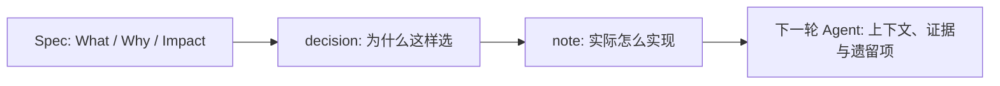

# Vibe Coding 最贵的 Bug：你和 Agent 以为在做同一个项目

Agent 说“完成了”，代码也跑起来了，人很容易先松一口气。等点进功能页，你才发现它做的是关键词匹配，而你要的是带权限、审计和降级策略的企业搜索。

这篇文章只谈两个问题：

1. 需求到底有没有讲清楚。现在 Spec 也开始由 AI 编写，人从作者变成了审阅者，审阅还能不能真的发生？
2. 执行过程中产生的隐性知识有没有留下来。这里已经不只是人没说出业务例外，还包括 AI 为什么选择某个实现、你们中途改过什么决定，以及下一轮 Agent 能不能看到这些信息。

这两个问题也决定 Agent 能否从“副驾”走向全自动研发。先看 Spec，再看执行过程，最后用自主等级框架看这条路线，并把做法收成流程。

## 一、Spec 写完了，人却可能被挡在循环外

一句话丢给 Agent，很快就能拿回一份结构完整、措辞严谨的 Spec。人看似省下了写作时间，角色也从编写者变成了审阅者。

审阅本身没有问题。代码 Review 一直是这么工作的。真正麻烦的是，你拿到的是一个一次生成完的长文档，里面塞着大量彼此牵连的定义、流程、异常和验收条件。人很难在有限时间里逐项追踪这些假设，于是很容易从认真审阅滑到扫一遍标题，再滑到只看 Agent 给出的风险摘要。

大 Diff 会让人扫一眼就点通过，大 Spec 更危险。代码至少还有编译器和测试，Spec 里的错误前提看起来却可以非常合理。等它被执行成代码，才发现权限模型不对、兼容范围漏了，或者一个“可选”功能根本不能失败。

这个问题不只是读得慢。Mitchell、Ghosh 和 Passi 在[《AI Agents Push Humans Out of the Loop》](../external-sources/ai-agents-push-humans-out-of-the-loop.md)这篇立场论文中认为，Agent 的输出密集、分散而且变化很快，人很难一边跟进计划，一边检查每个工具调用和参数。持续审批还会带来 approval fatigue。人只有能独立看清回路里的状态，human-in-the-loop 才有意义；否则名义上坐在回路里，实际已经失去了观察和干预能力。

更麻烦的是反馈环。如果系统把快速批准率当成成功信号，它会被激励去生成更流畅、更容易扫读、摩擦更小的方案。人越看不清，批准反而越容易发生。

Spec 的写作可以交给 Agent，Spec 的判断不能。要让审阅真的发生，得先让审阅材料变得可读。

人应该先写一份很短的决定单，而不是让 Agent 从零补全整个需求。里面放问题、非目标、硬约束、验收尺度和已知的未知项。Agent 先根据它给出一页决策骨架，列清关键取舍、依赖的假设和尚未解决的问题，再去补细节。

审阅时也只盯真正需要人负责的部分：目标有没有被换掉，硬约束有没有松，关键例子是否成立，有哪些方案被放弃了。措辞、章节顺序和背景复述可以让 Agent 自己处理。Spec 改到第二版以后，人应该看变化和决策差异，而不是把整份文档重新读一遍。

还有一个容易被忽略的关口：未解决的问题不能悄悄流进实现。要么在 Spec 里明确写成待决项，要么由人承担风险并记录理由。只要“到时候再说”还能直接触发编码，审阅就仍然只是个形式。

### 把 Spec 写成审阅者能快速判断的样子

仓库的 `AGENTS.md` 应该固定一套 Spec 输出约定，而不是任由 Agent 每次写一篇长文。最先出现的永远只有三段：What、Why、Impact。

| 段落 | 必须回答的问题 |
| --- | --- |
| What | 改什么，不改什么，完成后用户能看到什么变化？ |
| Why | 解决谁的什么问题，为什么现在值得做？ |
| Impact | 会碰哪些模块、数据、权限和兼容性，出问题时怎么回滚？ |

能画图的地方就直接画。调用链、数据流、状态变化和模块依赖优先用 Mermaid 图，再用一两句话说明图中最需要人确认的分支。流程顺序用 `sequenceDiagram`，对象关系用 `erDiagram`。结构本身就在图里时，再写一大段抽象描述只会增加审阅成本。

`AGENTS.md` 里可以只放下面几条：

```markdown
## Spec 协作
- 开头先写 What、Why、Impact，再按决策点展开。
- 调用链、数据流、状态和依赖优先画 Mermaid 图。
- 未决事项标为 UNKNOWN，确认前不得进入实现。
- 关键决策写入 docs/decisions/，实现变化写入 docs/notes/。
- 新任务开始前，先读相关 decision 和最新 note。
- 详细规范放 docs/spec-format.md，入口文件只保留链接和适用条件。
```

[AGENTS.md 官方格式](../external-sources/agents-md-official-format.md)把它定位成“给 Agent 的 README”，也支持在 monorepo 里用嵌套文件让最近的一层指令覆盖。按这个定位，入口只该放项目概览、执行命令、真正全局的硬约束和阅读路由；具体格式、图表示例和领域规范按任务按需加载。

长上下文也不会因为窗口够大就被完整利用。[《Lost in the Middle》](../external-sources/lost-in-the-middle.md)在两类检索任务中发现，相关信息出现在开头或结尾时，模型通常表现更好；落在长上下文中间时，表现会明显下降。所以重要规则要靠近开头或结尾，剩下的细节拆出去。把几百行内容塞进入口，效果不是 Agent 看得更多，而是容易把真正重要的规则埋掉。

## 二、真正的隐性知识，正在从执行过程中长出来

过去谈隐性知识，主要指那些人有、但没写下来的东西，比如客户为什么不能接受某个失败率，或者两个系统之间有一条没人敢动的历史依赖。

现在多了一层。Agent 在执行时会做很多选择，也会遇到很多现场信息：为什么用这个状态模型，为什么不选另一个方案，哪条测试一开始一直失败，你在对话里临时接受了什么折中。最终代码只保留结果，完整聊天记录又堆满噪声。中间那层判断经常直接消失。

这会带来两个后果。人可能只拿到了能运行的实现，却讲不清关键路径和失败边界；下一个 Agent 也可能只看到代码，不知道上一轮为什么这样做。

如果一个人说不出主要流程、选择了哪些方案、哪些行为不能改，就还没有真正完成审阅。此时点“接受”，只是把理解工作推给未来。

下一轮接手的人或 Agent 至少要知道当前 Spec 是哪一版，关键决定是什么，哪些假设还没有验证，失败时看到了什么证据，以及哪些问题被明确留给了后续。

靠不断在 prompt 里补“我们这个项目还有一条隐形规则”解决不了这个问题。对话会结束，后来接手的 Agent 只看到剩下的文件和上下文。更可靠的做法，是把两类信息拆开记录：

| 文档 | 记录什么 | 什么时候更新 |
| --- | --- | --- |
| decision | 问题、备选方案、最终选择、理由、证据、影响和复查条件 | 每次影响范围、架构、数据或风险的决策发生时 |
| note | 实际改了什么、与 Spec 的偏差、失败尝试、验证结果、遗留风险和下一步 | 每个实现检查点完成时 |

decision 回答“为什么这样做”，note 回答“最后做成了什么、过程中发生了什么”。两者不要揉成一份事后总结。决策发生时就写，能保留当时的备选方案和约束；实现过程中持续补 note，才不会把临时绕路和未验证假设伪装成最终设计。



目录可以简单到 `docs/decisions/<topic>.md` 和 `docs/notes/<change>.md`。`AGENTS.md` 只写这两类文档何时必读、模板在哪里，不把每份决策全文塞进入口文件。新的 Agent 开始工作前，先读相关 decision 和最新 note，再读代码。这样它拿到的不是一段无法复现的聊天记忆，而是一条可以追溯的判断链。

Anthropic 的[《Effective harnesses for long-running agents》](../external-sources/anthropic-effective-harnesses-for-long-running-agents.md)把长任务比作工程师轮班：每个新会话都没有上一班的记忆，单靠 compaction 也不一定能把事情交接清楚。它的做法是让 Agent 用进度文件、功能清单和 git 历史重建状态，再在每个会话结束时留下可恢复的成果。

[《Harness design for long-running application development》](../external-sources/anthropic-harness-design-long-running-apps.md)又往前走了一步：生成者和评估者在写代码前协商 sprint contract，并通过文件读写来传递判断。日志、追踪和错误上下文只能回答系统实际做了什么；Spec、decision、note 和验收证据才能回答为什么这样做、当时发生了什么。只看其中一边，依然会掉进猜测。

因此，记录不能依赖 Agent 事后写一篇“复盘”。harness 要在关键关口自动留下决策台账，至少包括当时的问题、考虑过的方案、最后的选择、选择理由、验证证据和复查条件。阶段结束时，再把有效内容收紧成一份交接包。完整聊天记录不能代替它。

[Addy Osmani 的 Loop Engineering](../external-sources/addy-osmani-loop-engineering.md)把这种代价归成三件事：验证仍然在人身上，理解会在不读代码时腐烂，人也会因为 loop 跑得顺而进入认知投降。把 Agent 每轮积累上下文造成的成本单列，就成了前文说的四种沉默成本。Anthropic 的官方 harness 文章则把上下文处理落到 compaction 或带结构化交接的 context reset 上。

Spec 审阅变粗，会累积验证负债；人不再理解实现，问题会变成理解腐烂；最后只负责点接受，就是认知投降；而每轮都把旧历史重新塞回去，又会让过时判断继续制造噪声。

## 三、从副驾到全自动，研发会像自动驾驶一样逐级放开

如果把研发过程也看成驾驶，我同意方向：Agent 会从辅助驾驶走向自动研发。变化不会靠某天切一个总开关完成，更可能按任务、风险和可回滚程度逐级放开。

Feng、McDonald 和 Zhang 在[《Levels of Autonomy for AI Agents》](../external-sources/levels-of-autonomy-for-ai-agents.md)里把自主性当作独立的设计决定，而不是模型能力越高就自动进入更高等级。他们按用户承担的角色划出五级：

| 等级 | 用户角色 | 研发场景里的样子 | 人还保留什么 |
| --- | --- | --- | --- |
| L1 | 操作者 | 人定计划、拆任务，Agent 按需协助 | 完整流程和动作控制 |
| L2 | 协作者 | 人和 Agent 共同规划、分工和执行 | 随时修改、接管和换手 |
| L3 | 顾问 | Agent 规划和执行大部分工作，遇到专业判断时来问人 | 提供领域知识、偏好和硬约束 |
| L4 | 审批者 | Agent 独立推进，只在阻塞或高风险动作前找人 | 异常、权限和关键发布决定 |
| L5 | 观察者 | Agent 自主规划、实现、测试和迭代 | 日志审计、规则边界和紧急停止 |

这张表不是在给 Agent 排“聪明程度”。写文档、补测试、在隔离环境里改代码，可能较早进入 L4 或 L5；触碰生产数据、不可逆迁移或责任边界不清的任务，就应该慢一点。论文也明确说过，更多自主不等于更好的 Agent。

L5 听起来最接近你说的全自动研发。按论文定义，人在这个等级不再参与正常执行，只能通过活动日志观察，并用紧急停止开关介入。也就是说，人退出实时回路以后，目标定义、权限上限和停止条件反而要更早在系统外面定好。论文提出的 autonomy certificate，落到研发流程里就是“这个 Agent 在这类仓库、这类风险下最高能跑到哪一级”。

自动驾驶也一样。全自动驾驶不意味着没有交通规则、行车记录和紧急制动；它只意味着人不再持续握方向盘。研发走到 L5 后，Spec 不会消失，只会从人逐段编写的文档，变成 Agent 内部持续更新、供审计和纠错的计划承诺。决策台账也不会消失，它是多轮 Agent 之间唯一的连续记忆。

## 四、压缩后的协作流程

1. 先按任务风险和可回滚程度，定这一轮允许 Agent 跑到哪一级。
2. 人写决定单，说清问题、非目标、硬约束、验收尺度和未知项。
3. Agent 先交一页决策骨架，不直接生成完整 Spec。
4. 人只审目标、约束、关键例子和方案分歧，未解决项不能直接进入实现。
5. 实现按概念关口推进，每一段都要求 Agent 解释关键路径和失败边界。
6. 每轮结束写决策台账，下一次交给新的 Agent 前收成一份交接包。

流程真正减少的是重复阅读。文档数量未必会少，人却不必再把 Agent 生成的每一段话都当成阅读理解。最难的判断仍然要人看，这也是留下审阅者的意义。

## 别让自己变成审批按钮

Agent 可以写 Spec，可以写代码，也可以自动记录执行过程。它没法替你决定什么问题值得解决，也无法替你承担“这个结果可以上线”的判断。

全自动研发很可能就是终点，只是人不会从 L1 直接跳到 L5。自主等级越高，人的工作越会从写代码和处理细节，转向定义目标、设置权限、审计证据和处理异常。这个责任层如果没建好，L5 只是无人执行，不是自主驾驶：出了问题，没人知道它怎么开的，也没人能及时停下。

如果人只剩点击接受，表面上还在 loop 里，实际上已经变成了一个审批按钮。两个项目最后合不到一起，往往不是因为 Agent 不够快，而是从作者退成审阅者以后，审阅没有真正发生，执行中长出的新知识也没有传给下一轮。
