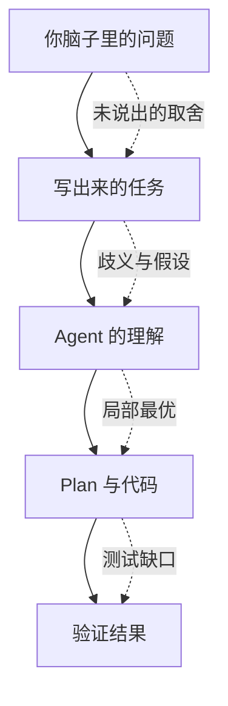

# Vibe Coding 最贵的 Bug：你和 Agent 以为在做同一个项目

Agent 说“完成了”，代码也跑起来了，人很容易先松一口气。等点进功能页，你才发现它做的是关键词匹配，而你要的是带权限、审计和降级策略的企业搜索。

未必是 Agent 不会做。它没参与你过去几次需求评审，也不知道哪些规则曾经被客户投诉；你同样没把这些东西写进仓库。双方各自补齐缺失的信息，代码越多，两个版本的“项目”越难合到一起。

这就是标题里说的“最贵”。返工之前，没人觉得自己做错了。

## 偏差常常藏在普通词里

“先简化一下”，有人想到减少依赖，有人以为要砍掉功能。“做个最小版本”，在一个团队里可能是能演示，在另一个团队里意味着能上线。这些词放在日常沟通里够用，放到 Agent 面前，就会变成一串没有说出口的默认值。

人脑里装着项目历史、组织结构、过去的故障和那些“差不多就行”与“绝不能改”的隐性判断。Agent 能用的，主要是你此刻给它的任务描述、代码和文档。它没经历过你经历过的上下文，只能从现有材料里补。



每转手一次，信息都会掉一部分。等代码生成出来，错误往往不是某一行写错了，而是整套实现都建立在一个没人确认过的前提上。它越完整，越像对的。

下面几类偏差最容易碰到：

| 偏差 | 现实里常见的样子 | 怎么提前卡住 |
| --- | --- | --- |
| 目标偏差 | 优化了一个不是你真正想要的结果 | 写明目标、非目标和完成定义 |
| 语义偏差 | 同一个词，双方理解不同 | 给术语表、正例和反例 |
| 上下文偏差 | 不知道组织习惯或历史决策 | 留下约束清单和决策记录 |
| 粒度偏差 | 对“最小版本”的尺度不一致 | 画范围、接口或验收样例 |
| 进展偏差 | 文件越来越多，人越来越不了解系统 | 做阶段解释和人工走查 |
| 验证偏差 | 测试绿灯，业务目标仍然失败 | 换用真实样本和分层验收 |

“给后台加一个导出功能”已经藏了格式、权限、数据量、审计和失败重试等假设。任何一项只在你脑子里，Agent 都只能猜。

## 动手前，先把“你应该懂”写出来

遇到稍大的任务，我现在会先停一下，不急着让 Agent 写代码。先补一页任务合同，哪怕只有半页：

```text
目标：要改变什么，为什么现在做？
完成定义：看到什么结果才算完成？
非目标：这次明确不做什么？
约束：哪些兼容性、性能、安全或架构边界不能碰？
参照：有没有相似实现、反例或真实业务样例？
未知项：哪些还没决定，遇到时该停下来问？
```

目标负责指路，真正管住范围的常是非目标和未知项。没有它们，Agent 很自然会顺手扩写，把“先做一个版本”理解成“把能想到的都做上”。

我最怕的一种回答是“我理解了”。它只能证明 Agent 愿意配合，不能证明你们想的是同一件事。让它用自己的话讲一遍目标，列出它正在采用的假设，再给一个可能被误实现的边界案例。哪一步卡住，就在那里补信息。

复述对了也别急着开工。双方完全可能共享同一个模糊词。追着一个具体例子问下去：

```text
给定什么输入？
发生什么情况？
系统应该怎么做？
什么行为绝对不该出现？
```

正常成功、可恢复失败、不可恢复失败，这三种输入往往比一大段形容词更能暴露分歧。如果连例子都举不出来，问题还在人这边。

## 别让它闷头跑

跨模块任务先看 Plan，再看 Diff。Plan 至少要说清楚动哪些模块、保留哪些行为、依赖哪些假设、怎么验证，以及什么情况下应该退回去。文件清单不够，最好配一张数据流或调用关系图。图里连不起来的地方，通常就是理解还没对齐的地方。

检查点也别按“写了几个文件”来设。接口定了、权限清了、失败路径跑过了，才算真过了一个关口。每一步尽量小到能解释、能验证、能撤回；一次报给你“全做完了”，最容易把中间的错误藏起来。

我有时会对方案形成明显倾向，这时直接问“这样写对吗”没什么用，容易得到顺着我说的一段分析。换个问法会好很多：

> 先别改代码。假设这个方案上线就出故障，列出最可能的三种原因，再给每个原因设计一个能快速证伪的实验。

功能单元结束后，再让 Agent 像给新同事介绍一样解释：为什么这么分层，为什么选这个数据结构，哪些地方最容易坏。人跟着复述一遍。解释不出来的模块，通常也谈不上被团队真正接手了。

这些动作仍然要人守在每一步旁边。会话一长，判断依据就会散在聊天记录里。

[《第十一讲. 让 agent 的运行过程可观测》](../external-sources/lecture-11-why-observability-belongs-inside-the-harness.md)把这类信息分成两层。运行时信号告诉我们系统实际做了什么；过程工件告诉我们为什么这个结果值得接受。日志能证明某个接口被调用过，却不一定说明这个改动为什么可以合并。两边都得看。

| 观测层 | 回答的问题 | 需要留下什么 |
| --- | --- | --- |
| 运行时 | 系统实际做了什么？ | 日志、追踪、关键路径、错误上下文、健康检查 |
| 过程 | 为什么接受这个结果？ | 合同、Plan、假设、评分标准、验收条件、人的决定 |

完整聊天记录不算可观测性。内容太多，决策、证据和临时猜测混在一起，下一个会话照样得从头猜。更实际的做法是固定几个检查点：这一轮依据哪版合同、采用了什么假设、观察到了什么、下一步验证什么。

采集项也别完全交给 Agent 临时决定。它不知道自己没记录什么，往往会漏掉人的判断标准。让 harness 固定收集，再定期对比 Agent 和人的判断在哪里分叉，把反复出现的问题写回合同、测试或评论规范。

## “测试通过”只是其中一张收据

测试全绿只能说明现有断言没有失败。代码可能仍然不符合真实目标，也可能和测试共享了同一个错误假设。

| 要验收什么 | 拿什么作证 |
| --- | --- |
| 核心行为 | 自动化测试、端到端流程、真实样例 |
| 边界行为 | 空数据、权限边界、并发和失败场景 |
| 既有能力 | 回归结果、兼容性检查、灰度观察 |
| 改动范围 | Diff、依赖和配置变化 |
| 能否维护 | 设计说明、操作方式和回滚路径 |

除了“做了什么”，还要问“哪里没做”和“哪里可能会坏”。再塞进一组不由实现反推出来的样本，比如用户真实输入、历史故障、业务规则或人工构造的反例。先写测试当然有用，但测试先得对准需求，否则只是把错误理解提前固定下来。

## 快本身不是问题，没人听见成本才是

Agent 跑起来以后，问题往往不会当天报错。[《第十三讲. 四种沉默成本》](../external-sources/lecture-13-four-silent-costs.md)列出了四种很容易被速度盖过去的东西：

| 沉默成本 | 它怎样影响协作 | 日常怎么检查 |
| --- | --- | --- |
| 验证负债 | “看起来没问题”开始替代验证 | 停止条件必须能检查，不能只靠感觉 |
| 理解腐烂 | 代码增长快过人的心智模型 | 读关键 Diff，持续解释并亲自使用 |
| 认知投降 | 人不再形成观点，只负责点接受 | 保留目标、硬约束和拒绝权 |
| 令牌爆炸 | 旧假设和旧错误不断回到上下文 | 版本化合同，压缩并清理历史 |

验证少一次，成本就转给下一轮；连续几次之后，人已经不知道绿色测试到底证明了什么。代码写得太快，也会把团队甩在后面。表面上每个人都在做决定，实际却只是转述 Agent 对系统的总结。

认知投降更安静。Agent 连续交付几个能用的小功能后，人很容易从共同定义问题，退成只按“接受”。讲座引用 Osmani 的话说得很直白：loop 不知道区别，你知道。

上下文越堆越满时，旧方案、废弃假设和失败尝试会获得和当前事实差不多的权重。Agent 甚至会把“以前这样想过”当成“现在仍然该这样”。保留一版有效合同、未解决问题和关键决策，通常比把全部历史重新塞回去更有用。

如果核心模块说不清为什么被接受，团队只能依赖笼统的绿灯，没人能讲完一条数据流，或者每一轮都要靠堆积历史维持记忆，就该停下来。继续加 prompt、加轮数、加 Agent，只会让噪音更多。

## 一套能长期用的节奏

1. 先写任务合同，补上非目标、约束和未知项。
2. 让 Agent 复述目标，列出假设，再给一个边界反例。
3. 看 Plan，同时确定要记录的运行时信号和过程证据。
4. 按概念关口小步实现，每步都能解释、验证和撤回。
5. 让 Agent 做反方审查，再用真实样本补足测试缺口。
6. 做一次解释回放，检查四种沉默成本有没有开始累积。
7. 把决策、硬边界和仍存在的风险写回仓库。

这套节奏看起来慢，省下来的其实是上线后重新排查、返工和重建理解的力气。任务合同写十分钟并不稀奇，真正贵的是半年后没人说得清一个模块为什么长成这样。

## 人留在回路里，比写更漂亮的提示词重要

没有任何 prompt 能让人和 Agent 永远保持同一理解。任务越新，歧义越多。能做的是让分歧早点露出来，并且留下足够的证据，让人有东西可查。

Agent 可以跑得很快，目标、验收尺度和暂停条件仍然得有人负责。观察做得再好，也只能告诉你系统和决策过程发生了什么，不能替你判断这个方向还值不值得走。

我在[《AI下半场，程序员如何与AI协作》](./2026-10-01-程序员当下如何与agent协作.md)和[《我对 harness 的理解》](./2026-06-08-我对harness的理解.md)里写过类似的判断：Agent 会放大输入。输入含糊，它就把含糊执行得更完整；输入有清楚的目标和证据，它才有可能放大真正的能力。

所谓减少认知偏差，说到底就是少让对方猜，也少让自己在“完成了”三个字面前放弃追问。
